# Modelo lógico completo do SIGA UEA (HT02 · SCRUM-107)

Gerado por [`modelo_logico.py`](modelo_logico.py); não edite à mão. O mesmo modelo gera o [`modelo-logico-siga-uea.drawio`](modelo-logico-siga-uea.drawio) (uma página por módulo) e o [`modelo-logico-siga-uea.sql`](modelo-logico-siga-uea.sql), que é executado num PostgreSQL para conferir chaves e restrições. O DER (modelo conceitual, estilo brModelo) que dá origem a este modelo está em [`der-conceitual-siga-uea.drawio`](der-conceitual-siga-uea.drawio).

**45 tabelas**: 14 já criadas pelas migrações (MOD01) e 31 planejadas para os próximos marcos. Os nomes seguem as entidades dos diagramas de sequência FL01 a FL10 (`MatriculaTurma` → `matricula_turma`, `ResultadoDefesa` → `resultado_defesa`).

## Histórico preservado (CA-02 da HT02)

| O que muda | Onde fica o histórico |
|---|---|
| Situação acadêmica do TCC | `historico_situacao` (cada transição, quem e quando) |
| Parecer da coordenação | `analise_cadastro` (uma linha por decisão; o protocolo não muda) |
| Orientador substituído | `orientacao` com status `SUBSTITUIDA`, data e justificativa; o novo vínculo é outra linha (RN16) |
| Versões do PDF | `documento_tcc` (versão nova a cada envio; a anterior permanece) |
| Remarcação, cancelamento, suplência | `historico_defesa` com os valores anteriores |
| Retificação do resultado | `resultado_defesa` com `versao` e `vigente`; ata e folha antigas ficam em `documento_oficial` com `substituido_em` |
| Instrumento de avaliação | `instrumento_avaliacao` versionado; cada avaliação aponta para a versão usada (RN19) |
| Situação editorial | `historico_publicacao`; outro veículo é outra `publicacao_artigo` |
| Qualquer alteração | `log_auditoria`, que o banco não deixa alterar nem apagar (RNF03) |

Indicadores (MOD06) e agenda (MOD07) não têm tabelas próprias: são consultas sobre `tcc`, `orientacao`, `banca_membro`, `publicacao_artigo` e `defesa` (`publicada`).

## Diagrama

```mermaid
erDiagram
    nucleo ||--o{ curso : "nucleo_id"
    usuario ||--o{ usuario_perfil : "usuario_id"
    perfil ||--o{ usuario_perfil : "perfil_id"
    usuario |o--o{ usuario_perfil : "atribuido_por"
    usuario ||--o| docente : "usuario_id"
    nucleo ||--o{ docente : "nucleo_id"
    curso |o--o{ docente : "curso_id"
    docente ||--o{ docente_area : "docente_id"
    area_interesse ||--o{ docente_area : "area_id"
    usuario ||--o| aluno : "usuario_id"
    curso ||--o{ aluno : "curso_id"
    usuario ||--o| foto_usuario : "usuario_id"
    usuario ||--o| usuario_externo : "usuario_id"
    usuario ||--o{ acesso_limitado : "usuario_id"
    defesa |o--o{ acesso_limitado : "defesa_id"
    tcc |o--o{ acesso_limitado : "tcc_id"
    usuario ||--o{ token_usuario : "usuario_id"
    usuario ||--o{ sessao : "usuario_id"
    usuario ||--o{ notificacao_email : "usuario_id"
    usuario |o--o{ log_auditoria : "usuario_id"
    usuario ||--o{ proposta : "autor_id"
    area_interesse |o--o{ proposta : "area_id"
    proposta ||--o{ proposta_destinatario : "proposta_id"
    docente ||--o{ proposta_destinatario : "professor_id"
    proposta ||--o{ comentario_proposta : "proposta_id"
    usuario ||--o{ comentario_proposta : "autor_id"
    curso ||--o{ turma : "curso_id"
    periodo_letivo ||--o{ turma : "periodo_id"
    docente ||--o{ turma : "professor_id"
    turma ||--o{ matricula_turma : "turma_id"
    aluno ||--o{ matricula_turma : "aluno_id"
    usuario ||--o{ matricula_turma : "incluido_por"
    aluno ||--o{ tcc : "aluno_id"
    turma ||--o{ tcc : "turma_id"
    periodo_letivo ||--o{ tcc : "periodo_id"
    area_interesse ||--o{ tcc : "area_id"
    tcc ||--o{ tcc_palavra_chave : "tcc_id"
    tcc ||--o{ historico_situacao : "tcc_id"
    usuario ||--o{ historico_situacao : "usuario_id"
    tcc ||--o{ analise_cadastro : "tcc_id"
    docente ||--o{ analise_cadastro : "coordenador_id"
    tcc ||--o{ orientacao : "tcc_id"
    usuario ||--o{ orientacao : "professor_id"
    tcc ||--o{ documento_tcc : "tcc_id"
    usuario ||--o{ documento_tcc : "enviado_por"
    tcc ||--o{ tarefa_tcc : "tcc_id"
    usuario ||--o{ tarefa_tcc : "cadastrada_por"
    tcc ||--o{ defesa : "tcc_id"
    local_defesa |o--o{ defesa : "local_id"
    docente ||--o{ defesa : "responsavel_id"
    defesa ||--o{ historico_defesa : "defesa_id"
    usuario ||--o{ historico_defesa : "usuario_id"
    defesa ||--o{ banca_membro : "defesa_id"
    usuario ||--o{ banca_membro : "usuario_id"
    usuario ||--o{ instrumento_avaliacao : "criado_por"
    instrumento_avaliacao ||--o{ componente_avaliacao : "instrumento_id"
    componente_avaliacao ||--o{ criterio_avaliacao : "componente_id"
    defesa ||--o{ avaliacao : "defesa_id"
    banca_membro ||--o{ avaliacao : "membro_id"
    instrumento_avaliacao ||--o{ avaliacao : "instrumento_id"
    avaliacao ||--o{ avaliacao_criterio : "avaliacao_id"
    criterio_avaliacao ||--o{ avaliacao_criterio : "criterio_id"
    defesa ||--o{ resultado_defesa : "defesa_id"
    usuario ||--o{ resultado_defesa : "confirmado_por"
    documento_tcc |o--o{ resultado_defesa : "versao_final_id"
    usuario |o--o{ resultado_defesa : "atraso_decidido_por"
    resultado_defesa ||--o{ correcao : "resultado_id"
    banca_membro ||--o{ correcao : "avaliador_id"
    usuario |o--o{ correcao : "decidida_por"
    defesa ||--o{ documento_oficial : "defesa_id"
    banca_membro |o--o{ documento_oficial : "membro_id"
    ouvinte_defesa |o--o{ documento_oficial : "ouvinte_id"
    defesa ||--o{ ocorrencia_defesa : "defesa_id"
    usuario ||--o{ ocorrencia_defesa : "autor_id"
    defesa ||--o{ ouvinte_defesa : "defesa_id"
    tcc ||--o{ publicacao_artigo : "tcc_id"
    publicacao_artigo ||--o{ historico_publicacao : "publicacao_id"
    usuario |o--o{ historico_publicacao : "usuario_id"
    nucleo {
        serial id PK
        varchar sigla UK
        varchar nome
    }
    curso {
        serial id PK
        varchar sigla UK
        varchar nome UK
        integer nucleo_id FK
    }
    area_interesse {
        serial id PK
        varchar nome UK
    }
    perfil {
        serial id PK
        varchar codigo UK
        varchar nome
    }
    usuario {
        serial id PK
        varchar nome
        varchar email UK
        varchar telefone
        varchar senha_hash
        boolean ativo
        timestamp inativado_em
        integer tentativas_falhas
        timestamp bloqueado_ate
        timestamp criado_em
    }
    usuario_perfil {
        integer usuario_id PK,FK
        integer perfil_id PK,FK
        integer atribuido_por FK
        timestamp atribuido_em
    }
    docente {
        integer usuario_id PK,FK
        varchar cargo
        integer nucleo_id FK
        integer curso_id FK
    }
    docente_area {
        integer docente_id PK,FK
        integer area_id PK,FK
    }
    aluno {
        integer usuario_id PK,FK
        varchar matricula UK
        integer curso_id FK
        date acesso_ate
    }
    foto_usuario {
        integer usuario_id PK,FK
        varchar tipo
        bytea conteudo
        char sha256
        timestamp atualizado_em
    }
    usuario_externo {
        integer usuario_id PK,FK
        varchar instituicao
    }
    acesso_limitado {
        serial id PK
        integer usuario_id FK
        varchar escopo
        integer defesa_id FK
        integer tcc_id FK
        timestamp expira_em
        timestamp revogado_em
        timestamp criado_em
    }
    token_usuario {
        serial id PK
        integer usuario_id FK
        varchar tipo
        char token_hash UK
        timestamp expira_em
        timestamp usado_em
        timestamp criado_em
    }
    sessao {
        serial id PK
        integer usuario_id FK
        char token_hash UK
        timestamp expira_em
        timestamp criado_em
    }
    notificacao_email {
        serial id PK
        integer usuario_id FK
        varchar tipo
        varchar destinatario
        varchar status
        integer tentativas
        text erro
        varchar entidade
        integer entidade_id
        timestamp criado_em
        timestamp enviado_em
    }
    log_auditoria {
        serial id PK
        integer usuario_id FK
        varchar acao
        varchar entidade
        integer entidade_id
        varchar campo
        text valor_anterior
        text valor_novo
        timestamp criado_em
    }
    proposta {
        serial id PK
        integer autor_id FK
        varchar titulo
        text descricao
        varchar destino
        integer area_id FK
        timestamp oculta_em
        timestamp criado_em
    }
    proposta_destinatario {
        integer proposta_id PK,FK
        integer professor_id PK,FK
    }
    comentario_proposta {
        serial id PK
        integer proposta_id FK
        integer autor_id FK
        text texto
        timestamp oculto_em
        timestamp criado_em
    }
    periodo_letivo {
        serial id PK
        varchar codigo UK
        date inicio
        date fim
        date prazo_versao_final
    }
    turma {
        serial id PK
        varchar codigo UK
        varchar disciplina
        integer curso_id FK
        integer periodo_id FK
        integer professor_id FK
        timestamp encerrada_em
        timestamp criado_em
    }
    matricula_turma {
        serial id PK
        integer turma_id FK
        integer aluno_id FK
        varchar situacao
        numeric nota_final
        integer incluido_por FK
        timestamp incluido_em
        timestamp situacao_alterada_em
    }
    tcc {
        serial id PK
        integer aluno_id FK
        integer turma_id FK
        integer periodo_id FK
        varchar etapa
        varchar modalidade
        varchar titulo
        varchar subtitulo
        text resumo
        integer area_id FK
        varchar situacao
        varchar protocolo UK
        timestamp submetido_em
        timestamp concluido_em
        text desistencia_motivo
        integer tcc_origem_id FK
        timestamp criado_em
        timestamp atualizado_em
    }
    tcc_palavra_chave {
        integer tcc_id PK,FK
        smallint ordem PK
        varchar palavra
    }
    historico_situacao {
        serial id PK
        integer tcc_id FK
        varchar situacao_anterior
        varchar situacao_nova
        integer usuario_id FK
        text observacao
        timestamp registrado_em
    }
    analise_cadastro {
        serial id PK
        integer tcc_id FK
        integer coordenador_id FK
        varchar resultado
        text parecer
        timestamp decidido_em
    }
    orientacao {
        serial id PK
        integer tcc_id FK
        integer professor_id FK
        varchar papel
        varchar status
        timestamp solicitado_em
        timestamp respondido_em
        text motivo_recusa
        timestamp encerrado_em
        text justificativa_encerramento
    }
    documento_tcc {
        serial id PK
        integer tcc_id FK
        integer versao
        varchar finalidade
        varchar nome_arquivo
        integer tamanho_bytes
        char sha256
        varchar caminho
        integer enviado_por FK
        timestamp enviado_em
    }
    tarefa_tcc {
        serial id PK
        integer tcc_id FK
        text descricao
        date prazo
        integer cadastrada_por FK
        timestamp entregue_em
        varchar status
        timestamp criado_em
    }
    local_defesa {
        serial id PK
        varchar nome UK
        varchar descricao
    }
    defesa {
        serial id PK
        integer tcc_id FK
        varchar formato
        date data
        time inicio
        time fim
        integer local_id FK
        varchar link
        varchar situacao
        integer responsavel_id FK
        boolean publicada
        timestamp publicada_em
        boolean divulgar_link
        boolean revisao_banca
        timestamp criado_em
    }
    historico_defesa {
        serial id PK
        integer defesa_id FK
        varchar evento
        text motivo
        jsonb valores_anteriores
        integer usuario_id FK
        timestamp registrado_em
    }
    banca_membro {
        serial id PK
        integer defesa_id FK
        integer usuario_id FK
        varchar papel
        boolean interno
        timestamp convite_enviado_em
        boolean presente
        timestamp convocado_em
        integer substitui_membro_id FK
        text motivo_convocacao
    }
    instrumento_avaliacao {
        serial id PK
        integer versao UK
        boolean vigente
        integer criado_por FK
        timestamp criado_em
    }
    componente_avaliacao {
        serial id PK
        integer instrumento_id FK
        varchar nome
        numeric pontos
        smallint ordem
    }
    criterio_avaliacao {
        serial id PK
        integer componente_id FK
        varchar nome
        numeric peso
        text texto_exemplar
        text texto_competente
        text texto_necessita
        smallint ordem
    }
    avaliacao {
        serial id PK
        integer defesa_id FK
        integer membro_id FK
        integer instrumento_id FK
        varchar status
        text parecer
        numeric nota_total
        timestamp enviada_em
    }
    avaliacao_criterio {
        integer avaliacao_id PK,FK
        integer criterio_id PK,FK
        varchar conceito
        numeric nota
        numeric nota_ponderada
    }
    resultado_defesa {
        serial id PK
        integer defesa_id FK
        integer versao
        boolean vigente
        numeric media
        numeric nota_final
        boolean regra_qualis
        varchar resultado
        text parecer
        integer confirmado_por FK
        timestamp confirmado_em
        text motivo_retificacao
        date prazo_versao_final
        text prazo_motivo
        timestamp anuencia_em
        integer versao_final_id FK
        boolean entregue_com_atraso
        boolean atraso_aceito
        integer atraso_decidido_por FK
        timestamp atraso_decidido_em
    }
    correcao {
        serial id PK
        integer resultado_id FK
        text descricao
        integer avaliador_id FK
        varchar situacao
        text justificativa
        integer decidida_por FK
        timestamp decidida_em
    }
    documento_oficial {
        serial id PK
        integer defesa_id FK
        varchar tipo
        integer versao
        boolean vigente
        char sha256
        varchar caminho
        integer membro_id FK
        integer ouvinte_id FK
        timestamp gerado_em
        timestamp substituido_em
    }
    ocorrencia_defesa {
        serial id PK
        integer defesa_id FK
        text texto
        integer autor_id FK
        timestamp criado_em
        timestamp alterada_em
    }
    ouvinte_defesa {
        serial id PK
        integer defesa_id FK
        varchar nome
        varchar matricula
        timestamp criado_em
    }
    publicacao_artigo {
        serial id PK
        integer tcc_id FK
        varchar tipo_veiculo
        varchar veiculo
        varchar qualis
        varchar doi
        varchar situacao_atual
        timestamp criado_em
    }
    historico_publicacao {
        serial id PK
        integer publicacao_id FK
        varchar situacao
        date data
        integer usuario_id FK
        timestamp registrado_em
    }
```

## Dicionário de dados

### MOD01 · Usuários e acesso

**`nucleo`** (criada) · Núcleo acadêmico (NUCOMP). Requisitos: RBN01.01

| Coluna | Tipo | Chave | Nulo | Observação |
|---|---|---|---|---|
| `id` | SERIAL | PK | não |  |
| `sigla` | VARCHAR(20) | UK | não |  |
| `nome` | VARCHAR(150) |  | não |  |

**`curso`** (criada) · Cursos contemplados (RN01). Requisitos: RN01

| Coluna | Tipo | Chave | Nulo | Observação |
|---|---|---|---|---|
| `id` | SERIAL | PK | não |  |
| `sigla` | VARCHAR(10) | UK | não |  |
| `nome` | VARCHAR(100) | UK | não |  |
| `nucleo_id` | INTEGER | FK → nucleo | não |  |

**`area_interesse`** (criada) · Áreas de interesse mantidas pela coordenação. Requisitos: RBN01.02, RN25

| Coluna | Tipo | Chave | Nulo | Observação |
|---|---|---|---|---|
| `id` | SERIAL | PK | não |  |
| `nome` | VARCHAR(100) | UK | não |  |

**`perfil`** (criada) · Os cinco perfis de acesso (RN07). Requisitos: RN07

| Coluna | Tipo | Chave | Nulo | Observação |
|---|---|---|---|---|
| `id` | SERIAL | PK | não |  |
| `codigo` | VARCHAR(30) | UK | não |  |
| `nome` | VARCHAR(50) |  | não |  |

**`usuario`** (criada) · Toda pessoa que acessa o sistema. Requisitos: RBN01.01 a RBN01.08

| Coluna | Tipo | Chave | Nulo | Observação |
|---|---|---|---|---|
| `id` | SERIAL | PK | não |  |
| `nome` | VARCHAR(150) |  | não |  |
| `email` | VARCHAR(254) | UK | não | único em lower(email) |
| `telefone` | VARCHAR(20) |  | sim |  |
| `senha_hash` | VARCHAR(60) |  | sim | bcrypt; nulo até ativar |
| `ativo` | BOOLEAN |  | não |  |
| `inativado_em` | TIMESTAMP |  | sim |  |
| `tentativas_falhas` | INTEGER |  | não |  |
| `bloqueado_ate` | TIMESTAMP |  | sim |  |
| `criado_em` | TIMESTAMP |  | não |  |

**`usuario_perfil`** (criada) · Perfis de cada pessoa e quem os atribuiu. Requisitos: RN07

| Coluna | Tipo | Chave | Nulo | Observação |
|---|---|---|---|---|
| `usuario_id` | INTEGER | PK FK → usuario | não |  |
| `perfil_id` | INTEGER | PK FK → perfil | não |  |
| `atribuido_por` | INTEGER | FK → usuario | sim |  |
| `atribuido_em` | TIMESTAMP |  | não |  |

**`docente`** (criada) · Dados de quem é docente (coordenador, professor, orientador). Requisitos: RBN01.01

| Coluna | Tipo | Chave | Nulo | Observação |
|---|---|---|---|---|
| `usuario_id` | INTEGER | PK FK → usuario | não |  |
| `cargo` | VARCHAR(20) |  | não | valores: coordenador, professor, orientador |
| `nucleo_id` | INTEGER | FK → nucleo | não |  |
| `curso_id` | INTEGER | FK → curso | sim | nulo = coordenador |

**`docente_area`** (criada) · Áreas de interesse de cada docente (RN25). Requisitos: RN25, RBN01.10

| Coluna | Tipo | Chave | Nulo | Observação |
|---|---|---|---|---|
| `docente_id` | INTEGER | PK FK → docente | não |  |
| `area_id` | INTEGER | PK FK → area_interesse | não |  |

**`aluno`** (criada) · Dados de quem é aluno. Requisitos: RBN01.03, RBN01.11

| Coluna | Tipo | Chave | Nulo | Observação |
|---|---|---|---|---|
| `usuario_id` | INTEGER | PK FK → usuario | não |  |
| `matricula` | VARCHAR(20) | UK | não |  |
| `curso_id` | INTEGER | FK → curso | não |  |
| `acesso_ate` | DATE |  | sim | aprovação em TCC2 + 7 dias (RN27); coluna planejada |

**`foto_usuario`** (criada) · Foto de perfil (opcional). Requisitos: RBN01.09, RBN01.10

| Coluna | Tipo | Chave | Nulo | Observação |
|---|---|---|---|---|
| `usuario_id` | INTEGER | PK FK → usuario | não |  |
| `tipo` | VARCHAR(20) |  | não |  |
| `conteudo` | BYTEA |  | não |  |
| `sha256` | CHAR(64) |  | não |  |
| `atualizado_em` | TIMESTAMP |  | não |  |

**`usuario_externo`** (planejada) · Membro de banca ou coorientador de fora da UEA (AcessoLimitado). Requisitos: RBN01.12, RBN01.13, RN12

| Coluna | Tipo | Chave | Nulo | Observação |
|---|---|---|---|---|
| `usuario_id` | INTEGER | PK FK → usuario | não |  |
| `instituicao` | VARCHAR(150) |  | não |  |

**`acesso_limitado`** (planejada) · Conta restrita a uma defesa ou a um TCC, com validade. Requisitos: RBN01.12, RBN01.13

| Coluna | Tipo | Chave | Nulo | Observação |
|---|---|---|---|---|
| `id` | SERIAL | PK | não |  |
| `usuario_id` | INTEGER | FK → usuario | não |  |
| `escopo` | VARCHAR(20) |  | não | valores: BANCA, COORIENTACAO |
| `defesa_id` | INTEGER | FK → defesa | sim |  |
| `tcc_id` | INTEGER | FK → tcc | sim |  |
| `expira_em` | TIMESTAMP |  | sim | 7 dias após o resultado |
| `revogado_em` | TIMESTAMP |  | sim |  |
| `criado_em` | TIMESTAMP |  | não |  |

Restrições: `CHECK (escopo = 'BANCA' AND defesa_id IS NOT NULL) OR (escopo = 'COORIENTACAO' AND tcc_id IS NOT NULL)`

**`token_usuario`** (criada) · Links de ativação e recuperação (só o hash). Requisitos: RBN01.05, RBN01.07

| Coluna | Tipo | Chave | Nulo | Observação |
|---|---|---|---|---|
| `id` | SERIAL | PK | não |  |
| `usuario_id` | INTEGER | FK → usuario | não |  |
| `tipo` | VARCHAR(20) |  | não | valores: ativacao, recuperacao |
| `token_hash` | CHAR(64) | UK | não |  |
| `expira_em` | TIMESTAMP |  | não |  |
| `usado_em` | TIMESTAMP |  | sim |  |
| `criado_em` | TIMESTAMP |  | não |  |

**`sessao`** (criada) · Sessões de login (60 min de inatividade). Requisitos: RBN01.06

| Coluna | Tipo | Chave | Nulo | Observação |
|---|---|---|---|---|
| `id` | SERIAL | PK | não |  |
| `usuario_id` | INTEGER | FK → usuario | não |  |
| `token_hash` | CHAR(64) | UK | não |  |
| `expira_em` | TIMESTAMP |  | não |  |
| `criado_em` | TIMESTAMP |  | não |  |

**`notificacao_email`** (criada) · Fila de e-mails de todos os módulos (NotificacaoEmail). Requisitos: RBN03.06, RBN04.05, RBN09.05, RBN12.03

| Coluna | Tipo | Chave | Nulo | Observação |
|---|---|---|---|---|
| `id` | SERIAL | PK | não |  |
| `usuario_id` | INTEGER | FK → usuario | não |  |
| `tipo` | VARCHAR(30) |  | não |  |
| `destinatario` | VARCHAR(254) |  | não |  |
| `status` | VARCHAR(10) |  | não | valores: pendente, enviado, falha |
| `tentativas` | INTEGER |  | não |  |
| `erro` | TEXT |  | sim |  |
| `entidade` | VARCHAR(40) |  | sim | ex.: tcc, defesa; coluna planejada |
| `entidade_id` | INTEGER |  | sim | coluna planejada |
| `criado_em` | TIMESTAMP |  | não |  |
| `enviado_em` | TIMESTAMP |  | sim |  |

**`log_auditoria`** (criada) · Log imutável de alterações (RNF03); trigger recusa UPDATE/DELETE. Requisitos: RNF03

| Coluna | Tipo | Chave | Nulo | Observação |
|---|---|---|---|---|
| `id` | SERIAL | PK | não |  |
| `usuario_id` | INTEGER | FK → usuario | sim |  |
| `acao` | VARCHAR(40) |  | não |  |
| `entidade` | VARCHAR(40) |  | não |  |
| `entidade_id` | INTEGER |  | sim |  |
| `campo` | VARCHAR(40) |  | sim |  |
| `valor_anterior` | TEXT |  | sim |  |
| `valor_novo` | TEXT |  | sim |  |
| `criado_em` | TIMESTAMP |  | não |  |

### MOD02 · Ideias de TCC

**`proposta`** (planejada) · Proposta de TCC de um aluno, direcionada a área ou a professores. Requisitos: RBN02.01, RN25

| Coluna | Tipo | Chave | Nulo | Observação |
|---|---|---|---|---|
| `id` | SERIAL | PK | não |  |
| `autor_id` | INTEGER | FK → usuario | não |  |
| `titulo` | VARCHAR(200) |  | não |  |
| `descricao` | TEXT |  | não |  |
| `destino` | VARCHAR(12) |  | não | valores: AREA, PROFESSORES |
| `area_id` | INTEGER | FK → area_interesse | sim | obrigatória se destino = AREA |
| `oculta_em` | TIMESTAMP |  | sim |  |
| `criado_em` | TIMESTAMP |  | não |  |

Restrições: `CHECK destino <> 'AREA' OR area_id IS NOT NULL`

**`proposta_destinatario`** (planejada) · Professores escolhidos quando destino = PROFESSORES. Requisitos: RBN02.01

| Coluna | Tipo | Chave | Nulo | Observação |
|---|---|---|---|---|
| `proposta_id` | INTEGER | PK FK → proposta | não |  |
| `professor_id` | INTEGER | PK FK → docente | não |  |

**`comentario_proposta`** (planejada) · Comentários de professores nas propostas. Requisitos: RBN02.02

| Coluna | Tipo | Chave | Nulo | Observação |
|---|---|---|---|---|
| `id` | SERIAL | PK | não |  |
| `proposta_id` | INTEGER | FK → proposta | não |  |
| `autor_id` | INTEGER | FK → usuario | não |  |
| `texto` | TEXT |  | não |  |
| `oculto_em` | TIMESTAMP |  | sim |  |
| `criado_em` | TIMESTAMP |  | não |  |

Restrições: `CHECK length(trim(texto)) > 0`

### MOD03 · Gestão e acompanhamento dos TCCs

**`periodo_letivo`** (planejada) · Período letivo AAAA/N e prazo da versão final (PeriodoLetivo). Requisitos: RBN08.01, RBN11.01

| Coluna | Tipo | Chave | Nulo | Observação |
|---|---|---|---|---|
| `id` | SERIAL | PK | não |  |
| `codigo` | VARCHAR(6) | UK | não | ex.: 2026/2 |
| `inicio` | DATE |  | não |  |
| `fim` | DATE |  | não |  |
| `prazo_versao_final` | DATE |  | sim |  |

Restrições: `CHECK fim > inicio`

**`turma`** (planejada) · Turma de TCC1 (disciplina) ou TCC2 (orientador). Requisitos: RBN08.01, RBN08.05, RN24, RN26

| Coluna | Tipo | Chave | Nulo | Observação |
|---|---|---|---|---|
| `id` | SERIAL | PK | não |  |
| `codigo` | VARCHAR(30) | UK | não |  |
| `disciplina` | VARCHAR(4) |  | não | valores: TCC1, TCC2 |
| `curso_id` | INTEGER | FK → curso | não |  |
| `periodo_id` | INTEGER | FK → periodo_letivo | não |  |
| `professor_id` | INTEGER | FK → docente | não | responsável (RN24, RN26) |
| `encerrada_em` | TIMESTAMP |  | sim |  |
| `criado_em` | TIMESTAMP |  | não |  |

Restrições: `único (curso_id, disciplina, periodo_id, professor_id)`

**`matricula_turma`** (planejada) · Aluno na turma e sua situação (MatriculaTurma). Requisitos: RBN08.02, RBN08.03, RN05

| Coluna | Tipo | Chave | Nulo | Observação |
|---|---|---|---|---|
| `id` | SERIAL | PK | não |  |
| `turma_id` | INTEGER | FK → turma | não |  |
| `aluno_id` | INTEGER | FK → aluno | não |  |
| `situacao` | VARCHAR(12) |  | não | valores: MATRICULADO, DESISTENTE, APROVADO, REPROVADO |
| `nota_final` | NUMERIC(3,1) |  | sim |  |
| `incluido_por` | INTEGER | FK → usuario | não |  |
| `incluido_em` | TIMESTAMP |  | não |  |
| `situacao_alterada_em` | TIMESTAMP |  | sim |  |

Restrições: `único (turma_id, aluno_id)` · `CHECK nota_final IS NULL OR nota_final BETWEEN 0 AND 10`

**`tcc`** (planejada) · O trabalho: cadastro, protocolo e situação acadêmica (TCC). Requisitos: RBN03.01 a RBN03.05, RBN08.04, RN04, RN10

| Coluna | Tipo | Chave | Nulo | Observação |
|---|---|---|---|---|
| `id` | SERIAL | PK | não |  |
| `aluno_id` | INTEGER | FK → aluno | não |  |
| `turma_id` | INTEGER | FK → turma | não |  |
| `periodo_id` | INTEGER | FK → periodo_letivo | não |  |
| `etapa` | VARCHAR(4) |  | não | valores: TCC1, TCC2 |
| `modalidade` | VARCHAR(10) |  | não | valores: ARTIGO, MONOGRAFIA |
| `titulo` | VARCHAR(300) |  | não |  |
| `subtitulo` | VARCHAR(300) |  | sim |  |
| `resumo` | TEXT |  | não | até 500 palavras |
| `area_id` | INTEGER | FK → area_interesse | não |  |
| `situacao` | VARCHAR(12) |  | não | valores: RASCUNHO, EM_ANALISE, APROVADO, DEVOLVIDO, REPROVADO, CONCLUIDO, DESISTENCIA |
| `protocolo` | VARCHAR(20) | UK | sim | gerado na 1ª submissão |
| `submetido_em` | TIMESTAMP |  | sim |  |
| `concluido_em` | TIMESTAMP |  | sim |  |
| `desistencia_motivo` | TEXT |  | sim |  |
| `tcc_origem_id` | INTEGER | FK → tcc | sim | TCC1 que originou o TCC2 |
| `criado_em` | TIMESTAMP |  | não |  |
| `atualizado_em` | TIMESTAMP |  | não |  |

Restrições: `único (aluno_id, periodo_id)`

**`tcc_palavra_chave`** (planejada) · Palavras-chave do TCC (no máximo 10). Requisitos: RBN03.01

| Coluna | Tipo | Chave | Nulo | Observação |
|---|---|---|---|---|
| `tcc_id` | INTEGER | PK FK → tcc | não |  |
| `ordem` | SMALLINT | PK | não |  |
| `palavra` | VARCHAR(60) |  | não |  |

Restrições: `CHECK ordem BETWEEN 1 AND 10`

**`historico_situacao`** (planejada) · Cada mudança de situação do TCC (HistoricoSituacao). Requisitos: RBN05.04, RN10

| Coluna | Tipo | Chave | Nulo | Observação |
|---|---|---|---|---|
| `id` | SERIAL | PK | não |  |
| `tcc_id` | INTEGER | FK → tcc | não |  |
| `situacao_anterior` | VARCHAR(12) |  | sim |  |
| `situacao_nova` | VARCHAR(12) |  | não |  |
| `usuario_id` | INTEGER | FK → usuario | não |  |
| `observacao` | TEXT |  | sim |  |
| `registrado_em` | TIMESTAMP |  | não |  |

**`analise_cadastro`** (planejada) · Decisões da coordenação sobre o cadastro (AnaliseCadastro). Requisitos: RBN04.01 a RBN04.05, RN06

| Coluna | Tipo | Chave | Nulo | Observação |
|---|---|---|---|---|
| `id` | SERIAL | PK | não |  |
| `tcc_id` | INTEGER | FK → tcc | não |  |
| `coordenador_id` | INTEGER | FK → docente | não |  |
| `resultado` | VARCHAR(10) |  | não | valores: APROVADO, DEVOLVIDO, REPROVADO |
| `parecer` | TEXT |  | não | obrigatório em DEVOLVIDO/REPROVADO |
| `decidido_em` | TIMESTAMP |  | não |  |

Restrições: `CHECK resultado = 'APROVADO' OR length(trim(parecer)) > 0`

**`orientacao`** (planejada) · Vínculos de orientação e coorientação, com histórico (Orientacao). Requisitos: RBN06.01 a RBN06.03, RN16

| Coluna | Tipo | Chave | Nulo | Observação |
|---|---|---|---|---|
| `id` | SERIAL | PK | não |  |
| `tcc_id` | INTEGER | FK → tcc | não |  |
| `professor_id` | INTEGER | FK → usuario | não | pode ser externo |
| `papel` | VARCHAR(12) |  | não | valores: ORIENTADOR, COORIENTADOR |
| `status` | VARCHAR(12) |  | não | valores: PENDENTE, ACEITA, RECUSADA, SUBSTITUIDA |
| `solicitado_em` | TIMESTAMP |  | não |  |
| `respondido_em` | TIMESTAMP |  | sim |  |
| `motivo_recusa` | TEXT |  | sim |  |
| `encerrado_em` | TIMESTAMP |  | sim |  |
| `justificativa_encerramento` | TEXT |  | sim |  |

**`documento_tcc`** (planejada) · Versões do PDF do TCC (DocumentoTCC). Requisitos: RBN07.01 a RBN07.04, RN11, RNF06

| Coluna | Tipo | Chave | Nulo | Observação |
|---|---|---|---|---|
| `id` | SERIAL | PK | não |  |
| `tcc_id` | INTEGER | FK → tcc | não |  |
| `versao` | INTEGER |  | não |  |
| `finalidade` | VARCHAR(12) |  | não | valores: PRELIMINAR, BANCA, FINAL |
| `nome_arquivo` | VARCHAR(255) |  | não |  |
| `tamanho_bytes` | INTEGER |  | não | até 20 MB |
| `sha256` | CHAR(64) |  | não |  |
| `caminho` | VARCHAR(500) |  | não |  |
| `enviado_por` | INTEGER | FK → usuario | não |  |
| `enviado_em` | TIMESTAMP |  | não |  |

Restrições: `único (tcc_id, versao)` · `CHECK tamanho_bytes BETWEEN 1 AND 20971520`

**`tarefa_tcc`** (planejada) · Tarefas/entregáveis definidos para um TCC aprovado. Requisitos: RBN05.05

| Coluna | Tipo | Chave | Nulo | Observação |
|---|---|---|---|---|
| `id` | SERIAL | PK | não |  |
| `tcc_id` | INTEGER | FK → tcc | não |  |
| `descricao` | TEXT |  | não |  |
| `prazo` | DATE |  | não |  |
| `cadastrada_por` | INTEGER | FK → usuario | não |  |
| `entregue_em` | TIMESTAMP |  | sim |  |
| `status` | VARCHAR(10) |  | não | valores: PENDENTE, ENTREGUE, ATRASADA |
| `criado_em` | TIMESTAMP |  | não |  |

### MOD04 · Gestão da defesa e agenda (MOD07)

**`local_defesa`** (planejada) · Salas e locais físicos de defesa (LocalDefesa). Requisitos: RBN09.03, RBN09.04

| Coluna | Tipo | Chave | Nulo | Observação |
|---|---|---|---|---|
| `id` | SERIAL | PK | não |  |
| `nome` | VARCHAR(100) | UK | não |  |
| `descricao` | VARCHAR(200) |  | sim |  |

**`defesa`** (planejada) · Agendamento da defesa e divulgação na agenda (Defesa). Requisitos: RBN09.01, RBN09.03, RBN09.07, RBN09.08, RBN14.01 a RBN14.04, RN09, RN14

| Coluna | Tipo | Chave | Nulo | Observação |
|---|---|---|---|---|
| `id` | SERIAL | PK | não |  |
| `tcc_id` | INTEGER | FK → tcc | não |  |
| `formato` | VARCHAR(10) |  | não | valores: PRESENCIAL, REMOTO, HIBRIDO |
| `data` | DATE |  | não |  |
| `inicio` | TIME |  | não |  |
| `fim` | TIME |  | não |  |
| `local_id` | INTEGER | FK → local_defesa | sim |  |
| `link` | VARCHAR(500) |  | sim |  |
| `situacao` | VARCHAR(10) |  | não | valores: CONFIRMADA, REMARCADA, CANCELADA, REALIZADA |
| `responsavel_id` | INTEGER | FK → docente | não | RN14 |
| `publicada` | BOOLEAN |  | não | agenda (RAN14) |
| `publicada_em` | TIMESTAMP |  | sim |  |
| `divulgar_link` | BOOLEAN |  | não |  |
| `revisao_banca` | BOOLEAN |  | não | orientador substituído |
| `criado_em` | TIMESTAMP |  | não |  |

Restrições: `CHECK fim > inicio` · `CHECK (formato = 'PRESENCIAL' AND local_id IS NOT NULL) OR (formato = 'REMOTO' AND link IS NOT NULL) OR (formato = 'HIBRIDO' AND local_id IS NOT NULL AND link IS NOT NULL)`

**`historico_defesa`** (planejada) · Agendamento, remarcação, cancelamento e suplência (HistoricoDefesa). Requisitos: RBN09.07 a RBN09.09

| Coluna | Tipo | Chave | Nulo | Observação |
|---|---|---|---|---|
| `id` | SERIAL | PK | não |  |
| `defesa_id` | INTEGER | FK → defesa | não |  |
| `evento` | VARCHAR(20) |  | não | valores: AGENDAMENTO, REMARCACAO, CANCELAMENTO, SUPLENTE_CONVOCADO |
| `motivo` | TEXT |  | sim |  |
| `valores_anteriores` | JSONB |  | sim |  |
| `usuario_id` | INTEGER | FK → usuario | não |  |
| `registrado_em` | TIMESTAMP |  | não |  |

**`banca_membro`** (planejada) · Membros da banca de uma defesa (BancaMembro). Requisitos: RBN09.01, RBN09.02, RBN09.05, RBN09.09, RN12, RN20

| Coluna | Tipo | Chave | Nulo | Observação |
|---|---|---|---|---|
| `id` | SERIAL | PK | não |  |
| `defesa_id` | INTEGER | FK → defesa | não |  |
| `usuario_id` | INTEGER | FK → usuario | não |  |
| `papel` | VARCHAR(12) |  | não | valores: AVALIADOR, ORIENTADOR, COORIENTADOR, SUPLENTE |
| `interno` | BOOLEAN |  | não |  |
| `convite_enviado_em` | TIMESTAMP |  | sim |  |
| `presente` | BOOLEAN |  | sim | para certificado |
| `convocado_em` | TIMESTAMP |  | sim | suplente chamado |
| `substitui_membro_id` | INTEGER | FK → banca_membro | sim |  |
| `motivo_convocacao` | TEXT |  | sim |  |

Restrições: `único (defesa_id, usuario_id)`

**`instrumento_avaliacao`** (planejada) · Versões do instrumento de avaliação (InstrumentoAvaliacao). Requisitos: RBN10.01, RN19

| Coluna | Tipo | Chave | Nulo | Observação |
|---|---|---|---|---|
| `id` | SERIAL | PK | não |  |
| `versao` | INTEGER | UK | não |  |
| `vigente` | BOOLEAN |  | não |  |
| `criado_por` | INTEGER | FK → usuario | não |  |
| `criado_em` | TIMESTAMP |  | não |  |

**`componente_avaliacao`** (planejada) · Parte escrita (7,0) e oral (3,0). Requisitos: RBN10.01

| Coluna | Tipo | Chave | Nulo | Observação |
|---|---|---|---|---|
| `id` | SERIAL | PK | não |  |
| `instrumento_id` | INTEGER | FK → instrumento_avaliacao | não |  |
| `nome` | VARCHAR(60) |  | não |  |
| `pontos` | NUMERIC(3,1) |  | não |  |
| `ordem` | SMALLINT |  | não |  |

**`criterio_avaliacao`** (planejada) · Critério com peso e texto dos três conceitos. Requisitos: RBN10.01, RBN10.03, RN19

| Coluna | Tipo | Chave | Nulo | Observação |
|---|---|---|---|---|
| `id` | SERIAL | PK | não |  |
| `componente_id` | INTEGER | FK → componente_avaliacao | não |  |
| `nome` | VARCHAR(120) |  | não |  |
| `peso` | NUMERIC(4,2) |  | não |  |
| `texto_exemplar` | TEXT |  | não |  |
| `texto_competente` | TEXT |  | não |  |
| `texto_necessita` | TEXT |  | não |  |
| `ordem` | SMALLINT |  | não |  |

**`avaliacao`** (planejada) · Avaliação de um membro da banca (Avaliacao). Requisitos: RBN10.02, RBN10.04, RBN10.05

| Coluna | Tipo | Chave | Nulo | Observação |
|---|---|---|---|---|
| `id` | SERIAL | PK | não |  |
| `defesa_id` | INTEGER | FK → defesa | não |  |
| `membro_id` | INTEGER | FK → banca_membro | não |  |
| `instrumento_id` | INTEGER | FK → instrumento_avaliacao | não |  |
| `status` | VARCHAR(10) |  | não | valores: RASCUNHO, ENVIADA |
| `parecer` | TEXT |  | sim |  |
| `nota_total` | NUMERIC(3,1) |  | sim |  |
| `enviada_em` | TIMESTAMP |  | sim |  |

Restrições: `único (defesa_id, membro_id)`

**`avaliacao_criterio`** (planejada) · Conceito e nota por critério (AvaliacaoCriterio). Requisitos: RBN10.03, RBN10.04

| Coluna | Tipo | Chave | Nulo | Observação |
|---|---|---|---|---|
| `avaliacao_id` | INTEGER | PK FK → avaliacao | não |  |
| `criterio_id` | INTEGER | PK FK → criterio_avaliacao | não |  |
| `conceito` | VARCHAR(12) |  | não | valores: EXEMPLAR, COMPETENTE, NECESSITA |
| `nota` | NUMERIC(3,1) |  | não |  |
| `nota_ponderada` | NUMERIC(4,2) |  | não | nota × peso ÷ 10 |

Restrições: `CHECK (conceito = 'EXEMPLAR' AND nota BETWEEN 8 AND 10) OR (conceito = 'COMPETENTE' AND nota BETWEEN 6 AND 7.9) OR (conceito = 'NECESSITA' AND nota BETWEEN 0 AND 5.9)`

**`resultado_defesa`** (planejada) · Resultado confirmado, versionado por retificação (ResultadoDefesa). Requisitos: RBN09.11, RBN09.12, RBN11.01, RBN11.02, RN13, RN21

| Coluna | Tipo | Chave | Nulo | Observação |
|---|---|---|---|---|
| `id` | SERIAL | PK | não |  |
| `defesa_id` | INTEGER | FK → defesa | não |  |
| `versao` | INTEGER |  | não |  |
| `vigente` | BOOLEAN |  | não |  |
| `media` | NUMERIC(3,1) |  | não |  |
| `nota_final` | NUMERIC(3,1) |  | não |  |
| `regra_qualis` | BOOLEAN |  | não | RN21 |
| `resultado` | VARCHAR(24) |  | não | valores: APROVADO, APROVADO_COM_CORRECOES, REPROVADO |
| `parecer` | TEXT |  | não |  |
| `confirmado_por` | INTEGER | FK → usuario | não |  |
| `confirmado_em` | TIMESTAMP |  | não |  |
| `motivo_retificacao` | TEXT |  | sim |  |
| `prazo_versao_final` | DATE |  | sim |  |
| `prazo_motivo` | TEXT |  | sim |  |
| `anuencia_em` | TIMESTAMP |  | sim |  |
| `versao_final_id` | INTEGER | FK → documento_tcc | sim |  |
| `entregue_com_atraso` | BOOLEAN |  | sim |  |
| `atraso_aceito` | BOOLEAN |  | sim |  |
| `atraso_decidido_por` | INTEGER | FK → usuario | sim |  |
| `atraso_decidido_em` | TIMESTAMP |  | sim |  |

Restrições: `único (defesa_id, versao)`

**`correcao`** (planejada) · Correções exigidas pela banca (Correcao). Requisitos: RBN11.01 a RBN11.04, RN17

| Coluna | Tipo | Chave | Nulo | Observação |
|---|---|---|---|---|
| `id` | SERIAL | PK | não |  |
| `resultado_id` | INTEGER | FK → resultado_defesa | não |  |
| `descricao` | TEXT |  | não |  |
| `avaliador_id` | INTEGER | FK → banca_membro | não |  |
| `situacao` | VARCHAR(10) |  | não | valores: PENDENTE, ATENDIDA, APROVADA, DEVOLVIDA |
| `justificativa` | TEXT |  | sim |  |
| `decidida_por` | INTEGER | FK → usuario | sim |  |
| `decidida_em` | TIMESTAMP |  | sim |  |

**`documento_oficial`** (planejada) · Ata, folha de aprovação, certificados e declarações (DocumentoOficial). Requisitos: RBN09.14 a RBN09.17, RN15, RN23

| Coluna | Tipo | Chave | Nulo | Observação |
|---|---|---|---|---|
| `id` | SERIAL | PK | não |  |
| `defesa_id` | INTEGER | FK → defesa | não |  |
| `tipo` | VARCHAR(16) |  | não | valores: ATA, FOLHA_APROVACAO, CERTIFICADO, DECLARACAO_HORAS |
| `versao` | INTEGER |  | não |  |
| `vigente` | BOOLEAN |  | não |  |
| `sha256` | CHAR(64) |  | não |  |
| `caminho` | VARCHAR(500) |  | não |  |
| `membro_id` | INTEGER | FK → banca_membro | sim | certificado |
| `ouvinte_id` | INTEGER | FK → ouvinte_defesa | sim | declaração |
| `gerado_em` | TIMESTAMP |  | não |  |
| `substituido_em` | TIMESTAMP |  | sim |  |

**`ocorrencia_defesa`** (planejada) · Ocorrências registradas na sessão (OcorrenciaDefesa). Requisitos: RBN09.10, RN23

| Coluna | Tipo | Chave | Nulo | Observação |
|---|---|---|---|---|
| `id` | SERIAL | PK | não |  |
| `defesa_id` | INTEGER | FK → defesa | não |  |
| `texto` | TEXT |  | não |  |
| `autor_id` | INTEGER | FK → usuario | não |  |
| `criado_em` | TIMESTAMP |  | não |  |
| `alterada_em` | TIMESTAMP |  | sim |  |

**`ouvinte_defesa`** (planejada) · Ouvintes presentes, para declaração de horas (OuvinteDefesa). Requisitos: RBN09.10, RN23

| Coluna | Tipo | Chave | Nulo | Observação |
|---|---|---|---|---|
| `id` | SERIAL | PK | não |  |
| `defesa_id` | INTEGER | FK → defesa | não |  |
| `nome` | VARCHAR(150) |  | não |  |
| `matricula` | VARCHAR(20) |  | sim |  |
| `criado_em` | TIMESTAMP |  | não |  |

### MOD05 · Publicação

**`publicacao_artigo`** (planejada) · Submissão do artigo a um veículo (PublicacaoArtigo). Requisitos: RBN03.02, RBN12.01, RN03, RN21

| Coluna | Tipo | Chave | Nulo | Observação |
|---|---|---|---|---|
| `id` | SERIAL | PK | não |  |
| `tcc_id` | INTEGER | FK → tcc | não |  |
| `tipo_veiculo` | VARCHAR(10) |  | não | valores: PERIODICO, CONGRESSO |
| `veiculo` | VARCHAR(200) |  | não |  |
| `qualis` | VARCHAR(2) |  | sim |  |
| `doi` | VARCHAR(200) |  | sim |  |
| `situacao_atual` | VARCHAR(12) |  | não | valores: SUBMETIDO, EM_REVISAO, ACEITO, RECUSADO, PUBLICADO |
| `criado_em` | TIMESTAMP |  | não |  |

Restrições: `CHECK situacao_atual <> 'PUBLICADO' OR doi IS NOT NULL`

**`historico_publicacao`** (planejada) · Sequência de situações editoriais (HistoricoPublicacao). Requisitos: RBN05.02, RBN12.01, RBN12.02

| Coluna | Tipo | Chave | Nulo | Observação |
|---|---|---|---|---|
| `id` | SERIAL | PK | não |  |
| `publicacao_id` | INTEGER | FK → publicacao_artigo | não |  |
| `situacao` | VARCHAR(12) |  | não | valores: SUBMETIDO, EM_REVISAO, ACEITO, RECUSADO, PUBLICADO |
| `data` | DATE |  | não |  |
| `usuario_id` | INTEGER | FK → usuario | sim | nulo = sistema (DOI) |
| `registrado_em` | TIMESTAMP |  | não |  |
