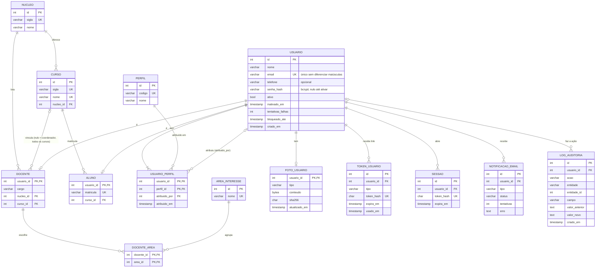

# Modelo de dados e contrato da API: módulo de usuários e acesso (MOD01)

Marco de integração 1: banco, módulo de usuários e contrato de API integrados.

| Artefato | Onde está |
|---|---|
| Tabelas (fonte da verdade) | [`backend/app/models.py`](../backend/app/models.py) |
| Migrações do banco (Alembic) | [`backend/migrations/versions/`](../backend/migrations/versions/) |
| Script SQL do PostgreSQL | [`docs/esquema-postgresql.sql`](esquema-postgresql.sql) |
| Contrato da API (OpenAPI 3) | [`docs/openapi.json`](openapi.json), ou `/docs` com a API no ar |
| **DER (modelo conceitual) do sistema, estilo brModelo** | [`docs/modelagem/der-conceitual-siga-uea.drawio`](modelagem/der-conceitual-siga-uea.drawio), 7 páginas (por módulo) |
| **Diagrama de implantação (UML)** | [`docs/modelagem/diagrama-implantacao-siga-uea.drawio`](modelagem/diagrama-implantacao-siga-uea.drawio): ambiente integrado (Vercel, Render e Neon) e ambiente local (Docker Compose); imagens em `docs/arquitetura/` |
| **Documento de Arquitetura do Sistema (HT03)** | [`docs/arquitetura/Arquitetura_do_Sistema_SIGA_UEA.docx`](arquitetura/Arquitetura_do_Sistema_SIGA_UEA.docx) e PDF, no formato dos documentos do grupo |
| **Contrato da API (HT03)** | [`docs/arquitetura/Contrato_da_API_SIGA_UEA.docx`](arquitetura/Contrato_da_API_SIGA_UEA.docx) e PDF (formato do grupo); versão para navegador em `docs/arquitetura/contrato-api-siga-uea.html`. As 51 operações, quem pode usar, corpo, resposta e códigos observados nos testes |
| **DER em pé de galinha (crow's foot)** | [`docs/modelagem/der-pe-de-galinha-siga-uea.drawio`](modelagem/der-pe-de-galinha-siga-uea.drawio): visão geral das 46 entidades, sistema completo com atributos e só o que já está implementado |
| **Modelo lógico completo (46 tabelas, todos os módulos)** | [`docs/modelagem/`](modelagem/modelo-logico-siga-uea.md): draw.io por módulo, dicionário de dados e DDL |
| Modelo lógico só do MOD01 (draw.io) | [`docs/modelo-logico-usuarios.drawio`](modelo-logico-usuarios.drawio) |

## Diagrama do modelo lógico (MOD01)

## Decisões de modelagem

| Decisão | Por quê | Requisito |
|---|---|---|
| `usuario` guarda o que é comum; `docente` e `aluno` são especializações 1:1 com a mesma chave | Login, sessão, perfis e auditoria tratam todo mundo igual; matrícula só existe para aluno, cargo e áreas só para docente | RBN01.01, RBN01.03 |
| Perfis em tabela própria (`perfil` + `usuario_perfil`), com quem atribuiu | Uma pessoa pode ter mais de um perfil, e ninguém atribui perfil a si mesmo | RN07, RBN01.01 |
| `docente.curso_id` nulo para coordenador | O coordenador acessa todos os cursos do núcleo | RBN01.01 |
| E-mail único por índice em `lower(email)` | `Ana@uea.edu.br` e `ana@uea.edu.br` são a mesma pessoa; o banco barra mesmo com dois cadastros simultâneos | RBN01.01 |
| Conta nasce com `senha_hash` nulo e `ativo = false` | Quem cadastra não define senha; a pessoa cria a própria pelo link | RBN01.05 |
| Tokens e sessões guardam só o SHA-256 | Quem lê o banco não consegue usar um link nem uma sessão | RNF02 |
| Sem exclusão de usuário (`inativado_em`) e chaves estrangeiras `RESTRICT` | Inativar bloqueia o acesso sem perder o histórico | RBN01.08 |
| `log_auditoria` só recebe `INSERT`: um trigger no banco recusa `UPDATE` e `DELETE` (migração 0003) | Quem fez, quando, qual campo, valor anterior e valor novo, sem poder ser adulterado | RNF03, HT07 |
| Foto em `bytea` com SHA-256, separada de `usuario` | A hospedagem não depende de disco; listar usuários não carrega imagens | RBN01.01, RNF06 |
| Datas em UTC, convertidas para America/Manaus na tela | Um único fuso no banco evita erro de comparação | RNF03 |

## Contrato da API (MOD01)

Todas as rotas ficam sob `/api/v1`. Erros sempre têm `detail` (mensagem para a tela) e, quando cabe, `campo`, `campos`, `criterios` ou `motivo` (ver [`backend/app/erros.py`](../backend/app/erros.py)).

| Método e rota | Quem pode | Requisito |
|---|---|---|
| `POST /auth/login`, `POST /auth/logout`, `GET /auth/me` | qualquer pessoa / logado | RBN01.06 |
| `POST /auth/validar-token`, `POST /auth/ativar` | público (link do e-mail) | RBN01.04, RBN01.05 |
| `POST /auth/esqueci-senha`, `POST /auth/redefinir-senha` | público | RBN01.07 |
| `POST /docentes`, `GET /docentes`, `GET /docentes/{id}` | coordenador | RBN01.01 |
| `POST /alunos`, `GET /alunos`, `GET /alunos/{id}` | coordenador | RBN01.03 |
| `PUT /usuarios/{id}`, `PATCH /usuarios/{id}/inativar`, `PATCH /usuarios/{id}/reativar` | coordenador | RBN01.08 |
| `POST /usuarios/{id}/reenviar-ativacao` | coordenador | RBN01.05 |
| `PUT /usuarios/{id}/foto`, `DELETE /usuarios/{id}/foto` | coordenador | RBN01.01 |
| `GET /usuarios/me`, `PUT /usuarios/me` | logado | RBN01.09, RBN01.10 |
| `PUT /usuarios/me/foto`, `DELETE /usuarios/me/foto`, `GET /usuarios/{id}/foto` | logado | RBN01.09, RBN01.10 |
| `POST /usuarios/me/senha` | logado | RBN01.04 |
| `GET /areas/gestao`, `POST /areas`, `PUT /areas/{id}`, `DELETE /areas/{id}` | coordenador | RBN01.02 |
| `GET /cursos`, `GET /areas`, `GET /perfis` | logado | RN01, RN07 |

Códigos de resposta usados: `400` validação, `401` sem sessão ou credenciais inválidas, `403` perfil sem permissão, `404` não encontrado, `409` duplicado, `413` arquivo grande, `415` formato não aceito, `422` senha fora da regra, `423` conta bloqueada.

## Contrato da API: cadastro de TCC (Sprint S03, Marco de integração 2)

Tabelas criadas pela migração `0004_cadastro_de_tcc`: `periodo_letivo`, `turma`, `matricula_turma`, `tcc`, `tcc_palavra_chave`, `historico_situacao`, `orientacao`, `publicacao_artigo` e `historico_publicacao`; `notificacao_email` ganhou `entidade` e `entidade_id`. Dicionário de dados em [`docs/modelagem/modelo-logico-siga-uea.md`](modelagem/modelo-logico-siga-uea.md).

| Método e rota | Quem pode | Diagrama / requisito |
|---|---|---|
| `GET /periodos`, `POST /periodos` | logado / coordenador | RBN08.01 |
| `GET /turmas`, `POST /turmas` | coordenador | RBN08.01 |
| `GET /turmas/{id}` | coordenador ou professor da turma (404 para os demais) | RAN08, RN24 |
| `GET /turmas/minhas` | logado: o docente vê as turmas que conduz; o aluno, a sua | RAN08, RN07 |
| `POST /turmas/{id}/alunos`, `PATCH /turmas/{id}/alunos/{matricula_id}` | coordenador | RBN08.02, RBN08.03 |
| `GET /tccs/formulario` | aluno | DS-FL01-A (403 sem matrícula, RN05) |
| `POST /tccs`, `PUT /tccs/{id}` | aluno | DS-FL01-B, RBN03.01, RBN03.02 (409 duplicado RN04, 409 não editável) |
| `POST /tccs/{id}/submissao` | aluno | DS-FL01, RBN03.03 a RBN03.05 (422 com `campos_pendentes`) |
| `GET /tccs`, `GET /tccs/{id}` | logado (cada perfil vê os seus, RN07) | RBN05.01 |
| `POST /tccs/{id}/orientacoes` | aluno | DS-FL03-B, RBN03.06 |
| `GET /orientacoes`, `GET /orientacoes/{id}` | orientador, professor | DS-FL03 |
| `POST /orientacoes/{id}/resposta` | orientador, professor | DS-FL03-A, RBN06.01 a RBN06.03 (409 se já respondida) |
